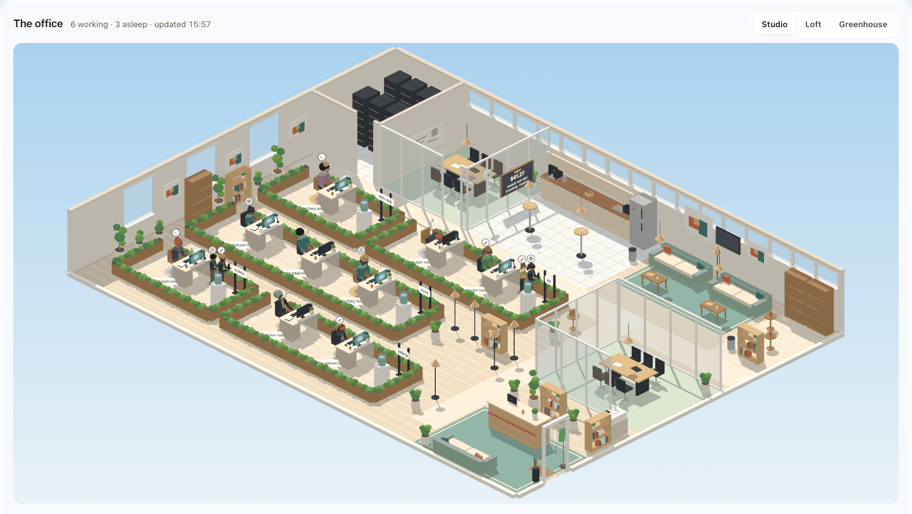
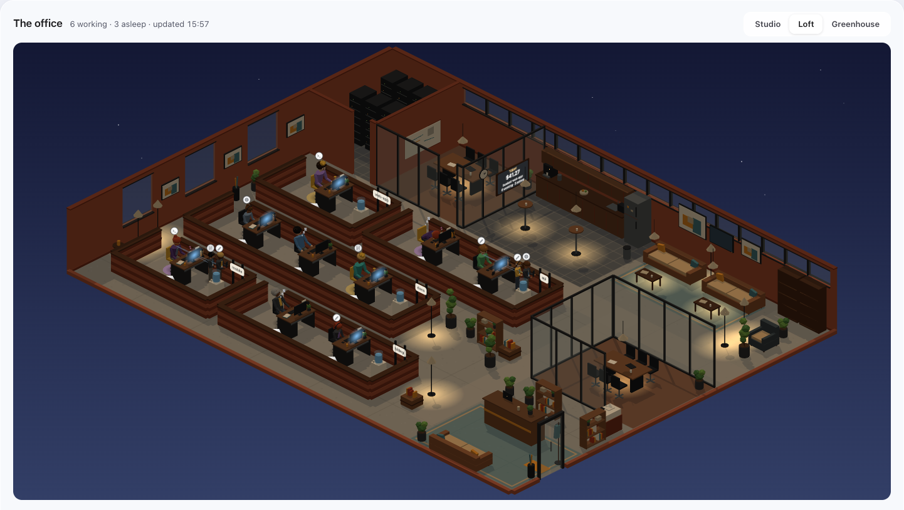
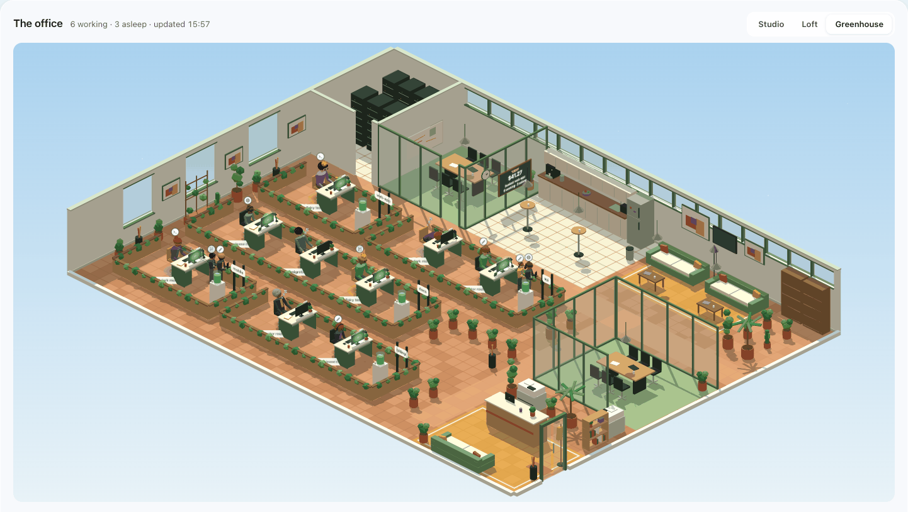
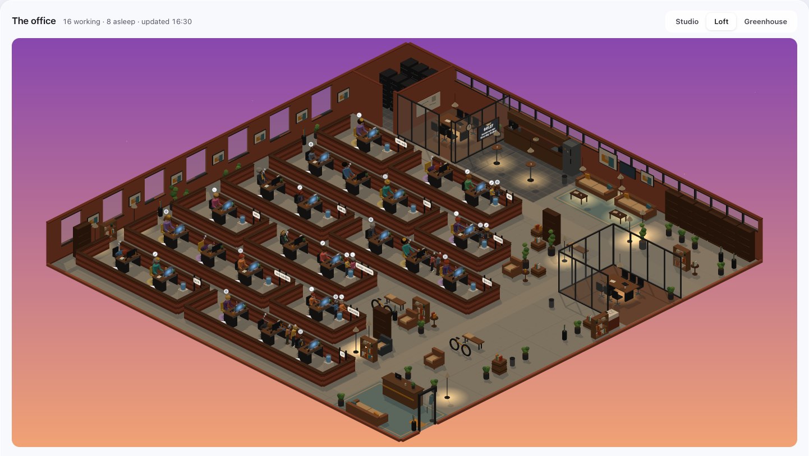

# Claude Code usage dashboard

This project gives you a local dashboard, a statusline and macOS
notifications for Claude Code. They show where the context and the dollars
of Claude Code go. They also warn you before a session gets to an automatic
compaction. All parts run on this machine against files that Claude Code
already writes to `~/.claude`. The project has no server component and no
account to sign in to.

The project costs no money to run. The dashboard makes no API calls to
Anthropic or to any other service. It parses local JSONL transcripts. For
dollar figures only, it runs `npx ccusage`, a local tool that reads the same
transcripts. If `ccusage` cannot run, the dashboard still works and shows
token counts instead of dollars. The dashboard does not estimate or guess a
value.

## What it looks like

The Office tab shows each Claude Code session that runs now as a worker at
a desk. This image shows the Studio theme by day.



## Requirements

- Python 3.15 or later. The project has no Python dependencies.
- [uv](https://docs.astral.sh/uv/). `install.sh` uses uv to find or install
  Python 3.15. `uv run` selects 3.15 from `.python-version`.
- Claude Code. Claude Code writes the transcripts under `~/.claude`.
- Optional: Node, so that `npx ccusage` can produce dollar figures.
- Optional, macOS only: `terminal-notifier` and `jq` for the desktop
  notifications. The dashboard and the statusline also work on Linux.

The default notifier path is `/opt/homebrew/bin/terminal-notifier`. This is
the Homebrew path on Apple Silicon. On an Intel Mac, the path is
`/usr/local/bin/terminal-notifier`. Set this path in two locations:

- Set `notifier` in `config.json`. The statusline notifications use this
  value.
- Set the `USAGE_NOTIFIER` environment variable in the shell that starts
  Claude Code. The `PreCompact` hook uses this value. The hook does not read
  `config.json`.

Step 3 of `install.sh` checks only the Apple Silicon path.

The `PreCompact` hook reads `jq` only from `/usr/bin/jq`. If that file is
missing, the hook exits silently and sends no notification.

## Quick start

With [uv](https://docs.astral.sh/uv/), you do not need a separate install
step. Run this command:

    uv run usage serve

Then open <http://127.0.0.1:8765>. The page refreshes itself every 60
seconds. You can also use these commands:

- `uv run usage refresh` runs one parse-and-cost pass on demand.
- `uv run usage report` prints the totals of the current month and the 10
  sessions with the highest spend. If dollar figures are not available, the
  report ranks the sessions by tokens. Add `--month YYYY-MM` to select a
  different month.

Without uv, any Python 3.15 interpreter works the same way. You do not
install dependencies. The macOS `python3` is 3.9, which is too old. Thus,
name the interpreter explicitly:

    python3.15 -m usage serve
    python3.15 -m usage refresh
    python3.15 -m usage report

## What the four tabs show

The Month, Sessions and Projects tabs show one **period**: a whole month or
a single day. The Office tab shows the sessions that run now. It ignores
the period. The header has two pickers. The first picker selects the month.
The second picker can select a day of that month with data. "Whole month"
goes back to the month.

Click a bar in the month chart to open that day. The URL holds the period
(`?period=2026-09` or `?period=2026-09-14`). Thus, you can bookmark and
reload a day view.

When `ccusage` cannot produce a dollar figure, each cost cell shows
"unavailable". The page then shows tokens. It never invents a number.

### Month

The Month tab shows the total tokens and dollars of the period to date.

For a month, the tab also shows:

- a projected total
- a daily bar chart, with actual bars and a faded projection for the rest of
  the month
- a comparison with the previous month

For a day, the tab also shows:

- 24 hourly bars and no projection
- a comparison with the previous day

For a day, the dashboard divides the ccusage cost of the day across its
hours by weighted tokens.

Below that, the tab shows:

- how much of the spend of the period was above the configured threshold
- a model split
- a token-type split (input / cache write / cache read / output)
- a **Skills and injected context** table

The table has one row for each skill that the Skill tool loaded. It has one
row for the injected context of each SessionStart hook. It also has one row
for the menu that lists the skills. Each row shows how many times the item was
loaded and its size in tokens. Each row also shows the "carried" tokens.
These are the tokens that the item cost because each later call of the
session read it again.

Skill and hook sizes come from the transcript. Recent Claude Code versions
record the injected text itself:

- an `invoked_skills` attachment for skills
- `hook_additional_context` and `skill_listing` attachments for the other
  items

The dashboard sizes this text at 4 bytes per token and shows the size as
exact. Some skills have no recorded text. For such a skill, the dashboard
estimates the size from the context growth on the call after the load. It
marks this size "est.".

Carried tokens count that text on each later call of the same transcript,
up to its next compaction. The compaction removes the text. The body of a
skill is the same in each session that loads it. Thus, if one session
recorded the skill, the dashboard sizes that skill exactly for all other
sessions too.

### Sessions

The Sessions tab shows each session that was active in the period as a row.
Each row shows the title, the directory, the cost or tokens, the peak
context and the loaded skills. The tab sorts the rows by spend. Click a row
to open a detail panel. The panel shows cost and token breakdowns, the
skills that the session carried, and the tips that fired for the session.

### Projects

The Projects tab shows the same figures, added together by project
directory. Use it to see which repo or client costs the most.

### Office

The Office tab shows each Claude Code session that runs now as a worker at a
desk. The office is an open-plan floor that three.js draws. Each project has
its own neighbourhood. A server room, rooms for meetings, a kitchen, a lounge, a
library and reception surround the neighbourhoods.

Use these controls:

- Select a theme in the panel head: Studio, Loft or Greenhouse.
- Drag to pan.
- Scroll to zoom.
- Hover over a worker to see the title, the model and the time in its
  current state. A worker that sleeps also shows the last message of its
  session.
- Click a worker to open its session on the Sessions tab.

The image at the top of this file shows the Studio theme. These images show
the two other themes:

| Loft at night | Greenhouse by day |
| --- | --- |
|  |  |

The screenshots use a fixed sky hour (`?hour=NN` in the URL).

#### Workers

A lead is the worker for a Claude Code session. A sub-agent is an intern
(see below). A worker types while its session is busy. It also types while
its session waits on a foreground sub-agent. Now and then it leans back to
think. When the session has been quiet for a minute, the worker dozes at the
desk with z's. Sleepers stay asleep at their desks.

Sometimes a lead that works takes a short break between thoughts. The break
is one of these:

- a drink at the cooler
- a chat with a colleague from the same project
- a walk to the kitchen or the lounge, where workers from different projects
  meet

When the process of the session stops, the worker walks to the door and
waves goodbye.


The session id selects the hair, the glasses, the coat and the shirt of
each worker. Thus, the same session always looks the same.

The model selects the tier. The tier sets the headgear, the halo, the chair
and the size of the worker. The Fable tier also replaces the coat with the
Fable coat. Only leads get the crown and the halo, never sub-agent interns.
The model tiers look like this (`dashboard/office-cast.js`):

- Opus wears a crown and a halo, and sits on a gold chair.
- Fable wears a monocle and a Fable coat, has a halo, and sits on a gold
  chair.
- Sonnet is an ordinary worker.
- Haiku is smaller and quicker, and wears headphones.

The notice board shows the real numbers of the day. Each desk screen lights
while its session works. The light follows your own clock. After hours, the
Office shows stars and lamps.

#### Sub-agents

Sub-agents show as interns at the pod of their lead. A tether connects each
intern to the worker that started it. A glyph shows the tool that the intern
uses. The Agents rail lists each sub-agent with its type, task, model,
tokens, tool count and current tool. The rail keeps finished sub-agents in
grey for two hours.

The floor grows to fit the projects. This image shows a floor with 12
projects:



#### Code and state

These three modules are DOM-free:

- the layout (`dashboard/office-floor.js`)
- the themes (`office-themes.js`)
- the behaviour (`office-sim.js`), a small state machine for each worker
  that steers the worker along the walkways

Thus, node can run them in `tests/office_*_check.js`. `office-3d.js` and the
modules that it imports draw them. `office.js` is the controller. The
project vendors three.js in `dashboard/vendor/three`, so the dashboard works
offline.

The state comes only from the statusline. Each statusline run stamps the
file of the session under `~/.claude/usage-state/`. The stamp holds the
time, the directory, the model, the transcript path and the Claude process
id. The Office uses no hooks. No part of the Office acts on a session.

The Office thresholds are in `config.json` under `office`:

- `working_seconds`: default 60.
- `gone_after_seconds`: default 86400. The Office uses it only when it does
  not know a process id.

## Thresholds and how to change them

The thresholds are in `config.json` at the repo root:

```json
{
  "threshold_tokens": 200000,
  "statusline": { "warn_tokens": 150000, "alert_tokens": 180000 }
}
```

- `threshold_tokens` (default 200000): the dashboard counts spend above this
  number of tokens as over-threshold. The shade of the daily bars and the "above
  threshold" percentage of the month summary use this value.
- `statusline.warn_tokens` (default 150000): the statusline segment becomes
  yellow. The first time that a session goes above this value, the
  statusline sends the "wrap up and /compact" notification (see below).
- `statusline.alert_tokens` (default 180000): the statusline segment becomes
  red. The statusline sends the "compact now" notification.

Edit `config.json`. The dashboard applies the change on the next refresh.
The statusline applies the change on its next run. You do not need to parse
again or restart.

## Install the statusline and alerts

    ./install.sh

This is the only part of the project that touches files outside this repo.
It runs in six steps. The first step must succeed. Each later step reports
its own result. Thus, one absent prerequisite does not stop the other steps.
Steps 3 to 5 report OK or WARN. Step 2 reports OK or FAIL. If step 2
fails, `install.sh` exits 1 at the end.

1. The script finds a Python 3.15 interpreter with
   `uv python find --system 3.15`. If it finds none, it runs
   `uv python install 3.15` and looks again. It prints FAIL and stops with
   exit 1 in these conditions:
   - uv is not installed.
   - It cannot find or install a 3.15 interpreter.
2. The script runs `<python> -m usage.install_settings` with that
   interpreter against `~/.claude/settings.json`. If `CLAUDE_CONFIG_DIR` is
   set, it overrides the `claude_dir` value of `config.json` for each
   component: installer, hook, statusline and dashboard. In that case, this
   step writes `$CLAUDE_CONFIG_DIR/settings.json` instead. This step does
   these actions:
   - It first makes a backup of the current file to
     `~/.claude/settings.json.bak-YYYYMMDD-HHMMSS`.
   - It sets `statusLine` to run `statusline/statusline.py` from this repo
     with the absolute path of that interpreter. When you run the installer
     again, it replaces an older `python3 ...` entry.
   - It adds a `PreCompact` hook (matcher `auto`) that runs
     `hooks/precompact-notify.sh`. It replaces each earlier registration of
     that same hook script. It does not change other hooks or other settings
     keys, for example model, plugins and theme.
   - It increases `cleanupPeriodDays` to at least 90. It never decreases a
     value that is already higher.
   - It removes `autoCompactWindow` if the value is exactly 200000. An
     earlier version of this installer wrote that value. This tool only
     alerts. It never decides when Claude Code compacts. It does not change
     a different value that you set yourself.

   If the current settings file is not valid JSON, this step fails. It
   prints one line that tells why, and it does not change the file. Each
   later step still runs, but `install.sh` exits 1 at the end.
3. The script installs `terminal-notifier` with Homebrew if
   `/opt/homebrew/bin/terminal-notifier` does not exist. If Homebrew itself
   is not installed, it prints manual install instructions.
4. The script makes sure that `npx -y ccusage@20.0.48 --version` prints a
   version. If not, this step reports WARN, not FAIL. The dashboard still
   works and shows tokens instead of dollars.
5. The script creates `~/.claude/usage-state/`. The statusline keeps its
   notification state for each session there.
6. The script prints the start command, the dashboard URL, and a one-line
   reminder about the one-time notification permission (see below).

After the install, start a new Claude Code session. The new session uses the
new statusline command.

### One-time notification permission

The first time that `terminal-notifier` sends a notification, macOS asks you
to allow or block its notifications. Step 6 of `install.sh` prints a test
command. Run that command to get the prompt immediately. If you miss the
prompt or it does not appear, do these steps:

1. Open **System Settings → Notifications**.
2. Find `terminal-notifier`.
3. Allow it.

You can also do a manual test with a fake statusline payload above the warn
threshold:

    echo '{"session_id":"test","session_name":"notification test","context_window":{"context_window_size":1000000,"used_percentage":19}}' \
      | "$(uv python find --system 3.15)" statusline/statusline.py

## What the notifications say, and when

Both notifications use `~/.claude/usage-state/<session_id>.json`. This file
records if a session already got a notification. Thus, each threshold sends
only one notification each time that the context goes above it. The record
resets if the context goes back below `warn`. This drop means that a
compaction occurred.

- **150,000 tokens (warn)**: "Context 150K in \<title\>: wrap up and
  /compact". The statusline segment becomes yellow at the same point.
- **180,000 tokens (alert)**: "Context 180K in \<title\>: compact now". The
  statusline segment becomes red.
- **When Claude Code compacts automatically**: the `PreCompact` hook runs
  first and sends "Auto-compact starting: \<title\>". Thus, you know that the
  compaction is about to start. This tool does not change when it occurs.
  Auto-compact stays as you set it in Claude Code (`/config`).

## Run at login (optional)

The installer does not install this. To start the dashboard automatically
at login, do these steps:

1. Save the text below as
   `~/Library/LaunchAgents/com.example.claude-usage.plist`.
2. Replace `/path/to/repo` with the absolute path of this repo.
3. Replace `/path/to/uv` with the output of `command -v uv`.
4. Replace `YOU` with your user name.

```xml
<?xml version="1.0" encoding="UTF-8"?>
<!DOCTYPE plist PUBLIC "-//Apple//DTD PLIST 1.0//EN" "http://www.apple.com/DTDs/PropertyList-1.0.dtd">
<plist version="1.0">
<dict>
    <key>Label</key>
    <string>com.example.claude-usage</string>
    <key>ProgramArguments</key>
    <array>
        <string>/path/to/uv</string>
        <string>run</string>
        <string>--directory</string>
        <string>/path/to/repo</string>
        <string>usage</string>
        <string>serve</string>
    </array>
    <key>WorkingDirectory</key>
    <string>/path/to/repo</string>
    <key>EnvironmentVariables</key>
    <dict>
        <key>PATH</key>
        <string>/opt/homebrew/bin:/usr/local/bin:/usr/bin:/bin:/Users/YOU/.local/bin</string>
    </dict>
    <key>RunAtLoad</key>
    <true/>
    <key>KeepAlive</key>
    <true/>
    <key>StandardOutPath</key>
    <string>/tmp/claude-usage.log</string>
    <key>StandardErrorPath</key>
    <string>/tmp/claude-usage.err</string>
</dict>
</plist>
```

Then load or unload it with these commands:

    launchctl load ~/Library/LaunchAgents/com.example.claude-usage.plist
    launchctl unload ~/Library/LaunchAgents/com.example.claude-usage.plist

The keys do these tasks:

- `RunAtLoad` starts the dashboard at login. It also starts the dashboard
  immediately when you `load` it.
- `KeepAlive` restarts the dashboard if it stops.
- `EnvironmentVariables.PATH` includes `/opt/homebrew/bin` and
  `/usr/local/bin`. Thus, ccusage finds `npx`/`node` when launchd starts the
  dashboard with its own minimal environment. launchd does not inherit the
  `PATH` of your shell. Without this key, costs show "unavailable", although
  the same command works correctly from a terminal.
- `WorkingDirectory` matches `--directory` above for the same reason. The
  default directory of launchd is `/`, not this repo.

## Logs

Each command writes logs to stderr:

- one line for each refresh: files read, sessions updated, calls, skill
  loads, if ccusage produced dollars, and elapsed time
- one `WARNING` line for each skipped transcript line or ccusage failure
- the one-time schema migration, when it runs

If a background refresh fails, it logs the traceback. It then tries again at
the next interval and does not stop. Add `-v` to get one `DEBUG` line for
each transcript file read (path, byte offset, bytes, calls):

    uv run usage -v serve

## Problems and solutions

- **The status line is blank or shows an error.** The statusline runs the
  Python 3.15 interpreter that `install.sh` pinned. uv can remove that
  interpreter, for example with `uv python uninstall` or a clean
  `~/.local/share/uv`. In that case, run `./install.sh` again to pin the
  current interpreter.
- **No notifications appear.** The probable cause is macOS permissions or
  Focus mode. Do these checks:
  - Make sure that System Settings → Notifications → terminal-notifier is
    allowed.
  - Make sure that Focus/Do Not Disturb does not silence it.
  - Run the manual test command above again.
- **Costs show "unavailable".** `ccusage` could not run. Make sure that
  `npx -y ccusage@20.0.48 --version` works from a terminal. This command
  needs Node. Look in the server logs for the last error. The dashboard
  always shows tokens, also when it cannot show dollars.
- **The dashboard looks stale.** The background refresh runs every 60
  seconds (`refresh_seconds` in `config.json`). If a refresh fails again and
  again, the page shows a "stale since" note. Restart `usage serve` to get
  an immediate refresh.

## How it works

- `usage/parser.py` reads the JSONL transcripts of Claude Code under
  `~/.claude/projects/` incrementally. It keeps a byte offset for each file,
  so that repeated parses are cheap.
- `usage/store.py` keeps the parsed records in a local SQLite database
  (`usage.db`). Thus, the server does not parse again on each request. The
  store has a schema version and migrates itself when it opens. Each version
  step resets all file offsets. Then the next refresh reads all transcripts
  again one time, which takes a few seconds. These are two version steps:
  - Version 3 added the skills tables and the call attribution for each
    transcript.
  - Version 4 added the local hour on each call and the hourly rollup that
    the day view uses.
- `usage/projection.py` turns the rollup into the totals, the trend and the
  chart series of the period.
- `usage/skills.py` puts the rows for each load together into the skills
  table.
- `usage/cost.py` joins those records with the JSON output of `npx ccusage`
  to add dollar figures.
- `usage/server.py` serves the static assets of the dashboard and two
  endpoints:
  - `/api/summary`. A background refresh thread supplies its data. It takes
    `?period=YYYY-MM` or `?period=YYYY-MM-DD`. `?month=` also still works.
    For all other values, it answers 400.
  - `/api/office` (usage/office.py). It reads the state files of the
    statusline and no database. The handler adds the numbers of today for
    the notice board (`board_stats` in usage/summary.py). These numbers are
    the only part of this payload that comes from the database.
- The server listens only on 127.0.0.1. It answers 403 to each request
  whose `Host` header is not `127.0.0.1:<port>` or `localhost:<port>`. Thus,
  a web page that rebinds its own DNS name to 127.0.0.1 cannot read your
  session titles and messages. The page is fluid up to 1680px wide.
- Claude Code itself runs `statusline/statusline.py` after each assistant
  message. The statusline reads the live context size of the same session
  from stdin. It never parses transcripts or uses the network, so it stays
  fast.
- `hooks/precompact-notify.sh` is the only part that runs as a Claude Code
  hook. This project does not run it directly.

## Dependencies and updates

Dependabot (`.github/dependabot.yml`) checks for updates each week. It
covers these ecosystems:

- npm: three.js. The dashboard serves a vendored copy in
  `dashboard/vendor/three`. The root `package.json` pins that version so
  that Dependabot can see it. No process runs `npm install`.
- uv: pytest, through `uv.lock`.
- github-actions: the actions in `.github/workflows/tests.yml`.

A Dependabot pull request that bumps `three` fails CI until you vendor it
again. To vendor it again, check out its branch and run this command:

    python3.15 scripts/vendor_three.py

You can also use `uv run scripts/vendor_three.py`. The script downloads the
tarball and checks it against the sha512 in `package-lock.json`. Then it
writes the vendored files and `VERSION` again. Commit the result.

Dependabot alerts and security updates are off until you turn them on. To
turn them on, go to **Settings → Code security** in the GitHub repository.
Then enable both.

## Design

`docs/design.md` is the design document. Code comments such as "spec Sec 12"
refer to its sections.

## Tests

    uv run --locked pytest -q

This command installs pytest from `uv.lock` into `.venv`, on Python 3.15.

The node checks for the Office (`tests/office_*_check.js`) run as part of
pytest when `node` is on the PATH. `tests/test_office_browser.py` loads the
Office in headless Chrome when Chrome is installed. GitHub Actions
(`.github/workflows/tests.yml`) runs the whole suite on macOS with Python
3.15. It runs on each push to `main` and on each pull request.
